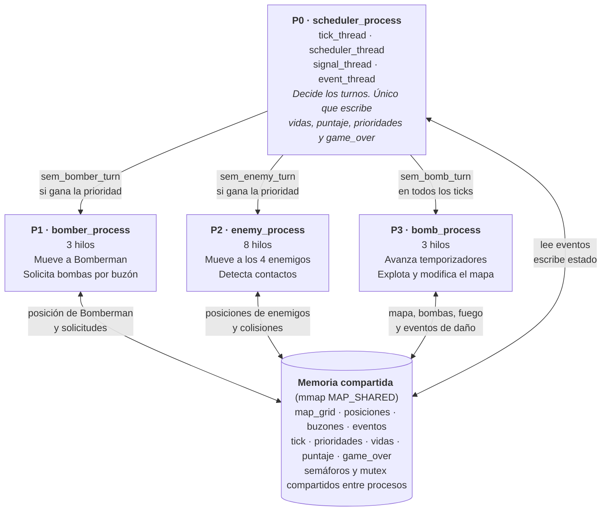
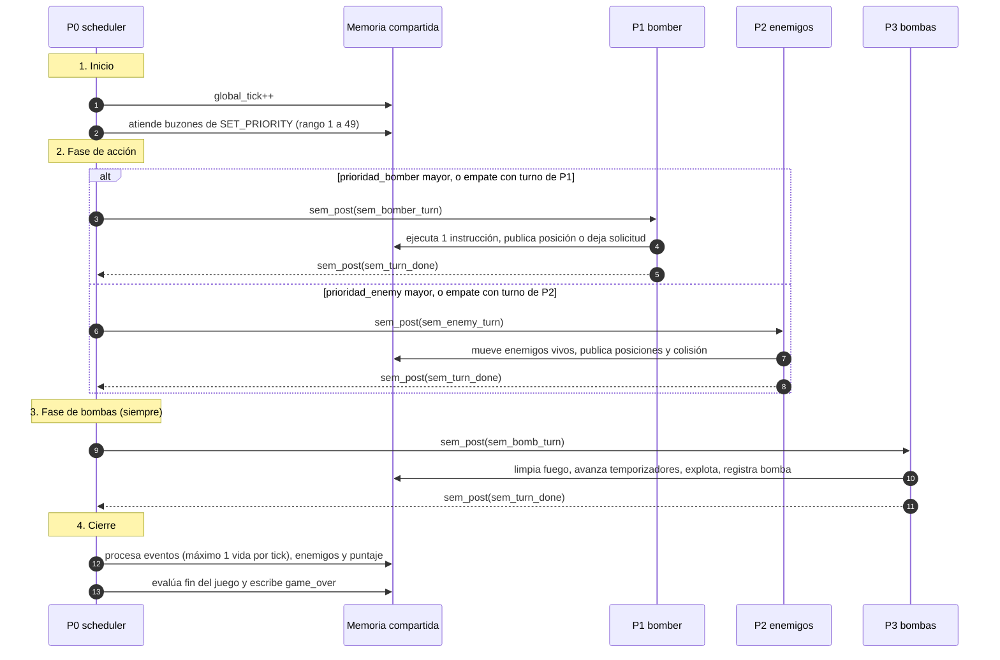
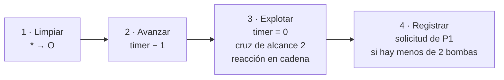
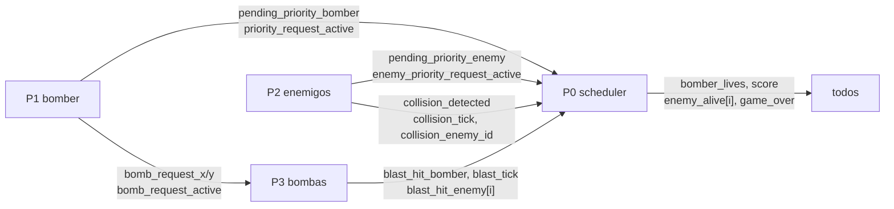

# P2 — Bomberman Concurrente: esquema, tiempos y diagramas

**Grupo:** Joel · Abigail · Mariel · Danilo
**Curso:** IS2021 Computing Systems
**Estado:** primer avance (semana 1)

Contenido:
1. [Diagrama general del sistema](#1-diagrama-general-del-sistema)
2. [Esquema de un tick](#2-esquema-de-un-tick)
3. [Qué sucede en cada T (ejemplo 8.5)](#3-qué-sucede-en-cada-t-ejemplo-85)
4. [Diagramas de tiempo según la prioridad](#4-diagramas-de-tiempo-según-la-prioridad)
5. [Comunicación por memoria compartida](#5-comunicación-por-memoria-compartida)
6. [Estado del código](#6-estado-del-código)

---

## 1. Diagrama general del sistema

Cuatro procesos creados con `fork()` desde P0. Ningún proceso se comunica directamente con otro:
P0 entrega los turnos con semáforos y todos los datos pasan por la memoria compartida.



### Hilos de cada proceso

| Proceso | Hilo | Función |
|---|---|---|
| **P0** scheduler | `tick_thread` | incrementa `global_tick` |
| | `scheduler_thread` | elige P1 o P2 según la prioridad (Round Robin si empatan) |
| | `signal_thread` | hace `sem_post` al semáforo del proceso elegido |
| | `event_thread` | procesa eventos: vidas, enemigos vivos, puntaje y `game_over` |
| **P1** bomber | `movement_reader_thread` | lee `bomber_moves.txt` y llena una cola interna |
| | `movement_executor_thread` | en cada turno ejecuta una instrucción de la cola |
| | `bomber_publisher_thread` | publica la posición de Bomberman en memoria compartida |
| **P2** enemigos | `enemy_controller_thread` | recibe el turno y despierta a los enemigos vivos |
| | `enemy_thread` × 4 | cada uno lee su archivo y mueve a su enemigo |
| | `bomber_tracker_thread` | mantiene una copia local de la posición de Bomberman |
| | `collision_thread` | detecta contacto enemigo–Bomberman y publica el evento |
| | `enemy_publisher_thread` | publica las posiciones de los enemigos |
| **P3** bombas | `bomb_controller_thread` | recibe el turno, coordina y registra la bomba solicitada |
| | `fuse_thread` | decrementa los temporizadores |
| | `explosion_thread` | limpia el fuego, propaga explosiones y publica el daño |

---

## 2. Esquema de un tick

Cada tick tiene cuatro fases. En cada fase solo trabaja un proceso hijo, y P0 espera su aviso
`sem_turn_done` antes de continuar.



### Orden interno de la fase de bombas (P3)



Consecuencia: una bomba solicitada en el tick *t* explota en el tick *t + 3*,
sin importar qué proceso tenga el turno en esos ticks.

---

## 3. Qué sucede en cada T (ejemplo 8.5)

Mapa de la sección 7, `bomber_moves.txt` de la sección 6, `prioridad_bomber = 40`, `prioridad_enemy = 30`.

```
x→ 0123456789A
y0 XXXXXXXXXXX
y1 XPOO#OOO#AX      P = Bomberman (1,1)
y2 XOX#XOXOXOX      A, B, C, D = enemigos
y3 XO#OOC#OOOX      # = bloque destructible
y4 XOXOX#XOXOX      X = pared
y5 XBO#OOO#ODX
y6 XXXXXXXXXXX
```

| T | 1. Inicio (P0) | 2. Acción | 3. Bombas (P3) | 4. Cierre (P0) |
|---|---|---|---|---|
| 1 | tick = 1 | **P1** `RIGHT` → (2,1) | sin bombas | vidas 3 · puntaje 0 |
| 2 | tick = 2 | **P1** `RIGHT` → (3,1) | sin bombas | vidas 3 · puntaje 0 |
| 3 | tick = 3 | **P1** `BOMB`: deja solicitud (3,1) | registra bomba en (3,1), timer 3, marca `Q` | vidas 3 · puntaje 0 |
| 4 | tick = 4 | **P1** `LEFT` → (2,1) | timer 2 | vidas 3 · puntaje 0 |
| 5 | tick = 5 | **P1** `LEFT` → (1,1) | timer 1 | vidas 3 · puntaje 0 |
| 6 | tick = 6 | **P1** `DOWN` → (1,2) | timer 0: **explota**. Fuego en (3,1), (2,1), (1,1). Destruye (4,1) y (3,2). Arriba lo detiene la pared (3,0) | Bomberman en (1,2), fuera del fuego · bloques 2 · **puntaje 20** |
| 7 | tick = 7 | **P1** `SET_PRIORITY 25`: deja solicitud | limpia el fuego `*` → `O` | vidas 3 · puntaje 20 |
| 8 | aplica prioridad 25 a P1 | **P2** (30 > 25) | — | — |

---

## 4. Diagramas de tiempo según la prioridad

`P0` actúa al inicio y al cierre de todos los ticks. `P3` recibe turno en todos los ticks.
La fase de acción la recibe **solo uno** entre P1 y P2.

Leyenda: 🟦 P1 Bomberman · 🟥 P2 enemigos · 🟨 P3 bombas · ⬛ P0 árbitro · ⬜ bloqueado esperando su semáforo

### Escenario A — prioridades iniciales (P1 = 20, P2 = 30): inanición de P1

| Proceso | T1 | T2 | T3 | T4 | T5 | T6 | T7 | T8 |
|---|---|---|---|---|---|---|---|---|
| P0 | ⬛ | ⬛ | ⬛ | ⬛ | ⬛ | ⬛ | ⬛ | ⬛ |
| P1 (20) | ⬜ | ⬜ | ⬜ | ⬜ | ⬜ | ⬜ | ⬜ | ⬜ |
| P2 (30) | 🟥 | 🟥 | 🟥 | 🟥 | 🟥 | 🟥 | 🟥 | 🟥 |
| P3 | 🟨 | 🟨 | 🟨 | 🟨 | 🟨 | 🟨 | 🟨 | 🟨 |

P1 nunca recibe turno, por lo tanto tampoco puede ejecutar su propio `SET_PRIORITY` (sección 9).

### Escenario B — ejemplo 8.5 (P1 = 40, P2 = 30; `SET_PRIORITY 25` en T7)

| Proceso | T1 | T2 | T3 | T4 | T5 | T6 | T7 | T8 | T9 |
|---|---|---|---|---|---|---|---|---|---|
| P0 | ⬛ | ⬛ | ⬛ | ⬛ | ⬛ | ⬛ | ⬛ | ⬛ aplica 25 | ⬛ |
| P1 | 🟦 | 🟦 | 🟦 BOMB | 🟦 | 🟦 | 🟦 | 🟦 SET 25 | ⬜ | ⬜ |
| P2 (30) | ⬜ | ⬜ | ⬜ | ⬜ | ⬜ | ⬜ | ⬜ | 🟥 | 🟥 |
| P3 | 🟨 | 🟨 | 🟨 registra | 🟨 3→2 | 🟨 2→1 | 🟨 💥 | 🟨 limpia | 🟨 | 🟨 |
| prioridad P1 | 40 | 40 | 40 | 40 | 40 | 40 | 40 | 25 | 25 |

La solicitud de T7 se aplica al **inicio** de T8 (sección 10), y desde ahí P2 tiene el turno.

```mermaid
gantt
    title Escenario B — proceso en ejecución por tick (eje = número de tick)
    dateFormat X
    axisFormat %s
    tickInterval 1second
    section P1 (40 → 25)
    RIGHT             :b1, 1, 2
    RIGHT             :b2, 2, 3
    BOMB              :b3, 3, 4
    LEFT              :b4, 4, 5
    LEFT              :b5, 5, 6
    DOWN              :b6, 6, 7
    SET_PRIORITY 25   :b7, 7, 8
    bloqueado         :done, b8, 8, 10
    section P2 (30)
    bloqueado (30 < 40) :done, e1, 1, 8
    mueve enemigos    :active, e2, 8, 10
    section P3 bombas
    sin bombas        :c1, 1, 3
    registra bomba    :c3, 3, 4
    timer 2           :c4, 4, 5
    timer 1           :c5, 5, 6
    EXPLOTA           :crit, c6, 6, 7
    limpia fuego      :c7, 7, 8
    sin bombas        :c8, 8, 10
```



### Escenario C — empate (P1 = 20, P2 = 20): Round Robin

| Proceso | T1 | T2 | T3 | T4 | T5 | T6 | T7 | T8 |
|---|---|---|---|---|---|---|---|---|
| P0 | ⬛ | ⬛ | ⬛ | ⬛ | ⬛ | ⬛ | ⬛ | ⬛ |
| P1 (20) | 🟦 | ⬜ | 🟦 | ⬜ | 🟦 | ⬜ | 🟦 | ⬜ |
| P2 (20) | ⬜ | 🟥 | ⬜ | 🟥 | ⬜ | 🟥 | ⬜ | 🟥 |
| P3 | 🟨 | 🟨 | 🟨 | 🟨 | 🟨 | 🟨 | 🟨 | 🟨 |



```mermaid
gantt
    title Escenario C — empate 20 = 20, Round Robin (eje = número de tick)
    dateFormat X
    axisFormat %s
    tickInterval 1second
    section P1 (20)
    RIGHT        :p1, 1, 2
    RIGHT        :p3, 3, 4
    BOMB         :p5, 5, 6
    LEFT         :p7, 7, 8
    section P2 (20)
    enemigos     :active, q2, 2, 3
    enemigos     :active, q4, 4, 5
    enemigos     :active, q6, 6, 7
    enemigos     :active, q8, 8, 9
    section P3 bombas
    sin bombas   :r1, 1, 5
    registra     :r5, 5, 6
    timer 2      :r6, 6, 7
    timer 1      :r7, 7, 8
    EXPLOTA      :crit, r8, 8, 9
```

Con el mismo `bomber_moves.txt`, la bomba se coloca en T5 en lugar de T3 y explota en T8.
En T8 Bomberman alcanzó a ejecutar un solo `LEFT` y está en (2,1), dentro del fuego: pierde una vida.
El resultado del juego depende de la planificación, no solo de los movimientos.

### Detalle de un tick en el tiempo (escenario B, T6)

```mermaid
gantt
    title Tick 6 por dentro — orden de las fases (tiempo relativo)
    dateFormat X
    axisFormat %s
    tickInterval 1second
    section P0
    1 Inicio tick++, buzones       :p0a, 0, 1
    espera turn_done de P1         :done, p0b, 1, 3
    espera turn_done de P3         :done, p0c, 3, 5
    4 Cierre eventos y fin         :p0d, 5, 6
    section P1
    2 Acción DOWN a (1,2)          :active, p1, 1, 3
    section P2
    bloqueado (no gana prioridad)  :done, p2, 0, 6
    section P3
    3 Bombas limpia, avanza, EXPLOTA :crit, p3, 3, 5
```



---

## 5. Comunicación por memoria compartida

Cada variable tiene un único proceso que la escribe. Cuando un proceso necesita que otro haga algo,
deja una **solicitud (buzón)** o un **aviso (evento)**; el receptor la atiende y baja la bandera.



| Variables | Escribe | Limpia | Protegida por |
|---|---|---|---|
| `global_tick`, `game_over`, `bomber_lives`, `score`, `enemy_alive[]` | P0 | — | `state_mtx` |
| `prioridad_bomber`, `prioridad_enemy` y buzones de prioridad | P0 / P1 / P2 | P0 | `prio_mtx` |
| `bomber_x`, `bomber_y`, `bomber_moves_done` | P1 | — | `bomber_mtx` |
| `bomb_request_*` | P1 | P3 | `bomb_req_mtx` |
| `enemy_x[]`, `enemy_y[]`, `enemy_moves_done` | P2 | — | `enemy_mtx` |
| `collision_*`, `blast_*` | P2 / P3 | P0 | `events_mtx` |
| `map_grid`, `active_bombs`, `blocks_destroyed` | P3 (P0 al iniciar) | — | `map_mtx` |

**Prevención de deadlock:** cuando un hilo necesita varios mutex, los toma siempre en el mismo orden:
`map_mtx → bomber_mtx → enemy_mtx → bomb_req_mtx → prio_mtx → events_mtx → state_mtx`.

---

## 6. Estado del código

Repositorio: https://github.com/JoelxD12O/bomberman-concurrente

| Componente | Responsable | Estado |
|---|---|---|
| Memoria compartida, semáforos y mutex entre procesos, `fork` de P1–P3 (`main.c`) | Joel | ✅ funcionando |
| Lectura y validación de `map.txt` (`map.c`) | Joel | ✅ funcionando |
| Parser de instrucciones (`parser.c`) + pruebas unitarias | Joel | ✅ 12/12 pruebas |
| P0: prioridades, Round Robin, buzones, vidas, puntaje, fin del juego (`scheduler.c`) | Joel | ✅ versión de 1 hilo |
| P1: movimiento de Bomberman y solicitudes (`bomber.c`) | Abigail | 🔧 en desarrollo |
| P2: movimiento de enemigos y colisiones (`enemy.c`) | Mariel | 🔧 en desarrollo |
| P3: bombas, explosiones y daño (`bomb.c`) | Danilo | 🔧 en desarrollo |
| División en hilos (`pthread`) de cada proceso | Todos | ⏳ semana 2 |
| Renderer P4 (bonus) | Abigail | ⏳ semana 3 |

### Ciclo principal de P0 (`src/scheduler.c`)

```c
while (!is_game_over(sh)) {
    /* 1. Inicio */
    sh->global_tick++;
    process_priority_requests(sh);

    /* 2. Fase de acción: P1 o P2 según la prioridad */
    if (le_toca_a_bomber(sh)) sem_post(&sh->sem_bomber_turn);
    else                      sem_post(&sh->sem_enemy_turn);
    sem_wait(&sh->sem_turn_done);

    /* 3. Fase de bombas: P3 en todos los ticks */
    sem_post(&sh->sem_bomb_turn);
    sem_wait(&sh->sem_turn_done);

    /* 4. Cierre */
    process_events(sh);
    check_end(sh);
}
```

### Pruebas realizadas sobre P0

| Prueba | Resultado |
|---|---|
| P1 = 20, P2 = 30 | P2 recibe todos los turnos (escenario A) |
| P1 solicita prioridad 40 | desde el tick siguiente P1 recibe todos los turnos |
| P2 solicita 20 (empate) | alternancia P1, P2, P1, … (escenario C) |
| Solicitud de prioridad 99 | descartada por fuera de rango |
| Colisión y explosión en el mismo tick | se descuenta 1 sola vida; con 0 vidas: derrota |
| 4 enemigos alcanzados | puntaje 400 y victoria |
| Mapas inválidos (filas desiguales, símbolo extraño, sin P, dos P) | rechazados con mensaje |
